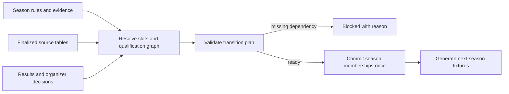

# Data-driven competition design

M1.2A proposal, 2026-11-07. No schema or runtime implementation. Authority: [verified rules and open questions](SWEDISH-COMPETITION-RULES-2026-27.md); integration points: [current architecture](CURRENT-LEAGUE-ARCHITECTURE.md).

## Recommended boundary

Separate stable identity, season rules, career participation and resolved outcomes. Country data describes progression; a generic competition service interprets it. Keep the current match engines and canonical club/rating data outside this service.

The smallest honest first delivery is definitions, validation and a **read-only transition planner**. Live movement must wait for complete source competitions or explicit evidenced external outcomes. The existing strength-ranked Division 1 selection is not an acceptable provider for the proposed model.

## Definitions

| Concept | Proposed information / responsibility |
| --- | --- |
| `CompetitionDefinition` | Stable existing ID; country, category, organizer, kind (league/cup/qualification), sporting tier, tier-family and group ID. N/S are sibling groups of one tier. No rule depends on a display name. |
| `CompetitionSeasonRules` | Immutable rule ID/version, season, target season, source URLs/sections, verification date and content digest; expected membership/capacity exceptions; regular format, points/ranking policies, entry slots, paths, calendar policy and administrative policies. |
| `CareerCompetitionSeason` | Career/season/competition IDs; pinned rule snapshot; participants; coverage status; phase; fixture/result references; finalized table and unresolved ranks. Preserve source membership separately from career membership. |
| `ParticipationPolicy` | Independent flags for manager selection, league simulation, market/economy activity and result provision. Catalog-only, background-simulated, manager-playable and external are distinct capabilities. |
| `MovementSlot` | Stable ID, finalized source-table selector, direction/target tier-family, eligibility/replacement policy, provenance, resolution status. Direct slots produce a destination claim; qualification slots feed a path. |
| `QualificationPath` | Directed acyclic graph of stages and named entrant ports. Inputs reference table slots or prior winners/losers. Format and home priority are explicit per node; equal rank across groups never implies a total order. |
| `QualificationOutcome` | Entrants, completed games/aggregate, winner/loser, method, origin (`CAREER_SIMULATED`, `OFFICIAL_IMPORTED`, `ADMINISTRATIVE_DECISION`), source/result references and unresolved reason. No probability-generated winner provider. |
| `TransitionPlan` | From/to seasons, input/rule digests, movement claims, retained clubs, boundary entries/exits, group allocations, unresolved dependencies and validation findings; `PENDING`, `BLOCKED`, `READY` or `APPLIED`. |
| `MembershipAssignment` | Club ID, season, competition/group, sporting status and originating slot/outcome/decision. Club identity, affiliation, ratings and squad are not recreated on movement. |

Represent sporting tier as a positive integer. Keep an explicit compatibility adapter for legacy economic bands; changing Division 1's sporting tier must not rewrite ratings, wages or ability data through an existing `1 | 2` economy assumption.

Use `VERIFIED`, `UNCONFIRMED` and `GAME_POLICY` provenance at field/policy level. A rule document being verified does not verify all inferred details or a club's licence. Store unresolved selectors as typed references with `clubId = absent`, never as fake clubs such as “Division 2 winner”.

## Selectors, eligibility and outcomes

A rank selector identifies a finalized table and rank, not a club-strength ranking. It waits for all source fixtures, applicable deciding matches and administrative decisions. Stable sorting may render a provisional table, but cannot confer an advancement right.

Eligibility returns `ELIGIBLE`, `INELIGIBLE` or `UNKNOWN`, with reason/evidence. Evaluate dated A/B relationships, restrictions relative to current-season and intended membership, accepted/declined entry, licences and organizer rulings. An unknown record stays pending. Replacement walks the official eligible rank range and records each skipped club and reason; it must not allocate one club to conflicting slots. Exhaustion invokes the configured vacancy/cancellation policy.

Paths use reusable `BEST_OF`, `TWO_LEG` and `SINGLE_DECIDER` formats. Each defines its wins/aggregate rule, whether individual games can draw, home pattern with a named reference entrant, terminal-decider policy and fixture-cancellation behavior after resolution. Reuse existing tie execution through an adapter. An unconfirmed home or terminal policy prevents enabling the affected path; resolving it later must not require an engine rewrite.

Winner/loser ports can produce promotion, relegation, retention, another-stage entry or a boundary claim. Reaching a semi-off win is not automatically promotion. Outcomes are deduplicated by rule/season/path/node; consumers never infer them from an inbox message or the manager's league.

## Transition process

1. **Freeze evidence:** pin current-season participants, complete source tables, rules, results and dated decisions. Every consumed competition must be complete; the manager's season cannot stand in for world completion.
2. **Resolve claims:** direct places and qualification results generate membership claims. Preserve the distinction between “qualified for next tier” and “allocated to a geographic group”.
3. **Resolve administration:** eligibility cascades, vacancies, appeals and allocations produce evidenced decisions. Do not automatically give an unsuccessful qualifier a vacancy or use sorted IDs to balance groups.
4. **Validate the whole plan:** one relevant men's league membership per club; known canonical IDs; no conflicting moves; expected capacities subject to recorded exceptions; all required outcomes resolved; boundary entries balance exits; complete allocations; fixture-generator capability supported.
5. **Apply atomically:** only a ready plan may replace current-season membership and archive its source tables/outcomes. Apply once using a transition ID and input digest. Repeating rollover/load must reproduce the same state; changed inputs invalidate a stale plan.
6. **Build the next season:** use finalized membership and an explicit next-season rule/calendar profile. Preserve offseason contracts, recovery and world ticks. Archive every simulated group's standings, not just the top two leagues.

## Incomplete pyramid policy

| Coverage | Required behavior |
| --- | --- |
| Known clubs, no league simulation (today's usual Division 1 case) | Catalog/market access remains valid. Do not infer finishing ranks. Wait for a full background season or evidenced external table/outcomes. |
| Unknown Division 2 entrants | Keep entry slots unresolved. Do not add placeholder clubs, reuse a relegated club as a replacement or invent results. A future import must register a verified real identity before it enters membership. |
| Known club relegated outside simulated scope | Preserve club, squad/history and a boundary destination claim. Do not assign it to an invented Division 2 group or delete it. A resolved external assignment can be stored without simulating that league. |
| Missing group allocation | Store target tier-family; block fixtures for that family until an explicit allocation is available. A game geography policy must be labeled and chosen separately from verified SHF allocations. |
| Manager leaves supported coverage | Show the actual relegation status and a specific progression limitation. Preserve the save; do not auto-retain the club, auto-win qualification or switch the manager's club. Career/job continuation requires a separate product decision. |
| No next-season rule profile | Block official-mode regeneration. An explicitly selected inherited game-rule profile is possible later; never label it verified 2027/28 regulation. |

Full background Division 1 would allow its own table selectors to resolve, but still would not supply Division 2 identities, results, eligibility or next-year allocations. These are separate dependencies. A closed playable floor would change real sporting outcomes and is **not** the default recommendation.

## Fixture regeneration and integration

Use exact imported season/participant coverage when available. Otherwise generate a game calendar from finalized membership, never reuse the previous season's opponent list. Fixture identity includes career-season, competition, stage and game; preserve external match IDs separately. Validate pair coverage, home/away counts, dates/rest, unique IDs and absence of already-used results. Odd memberships require a bye-capable generator or an explicit unsupported-format finding; do not silently pad the league.

Retain `competitionMembership` as an adapter for existing readers while moving authority to season assignments. Route tables, AI match scheduling, tier-dependent services, board objectives and competition UI through the same resolver. World-market activity stays separately configured. Adding another country should require a rule package, participants and supported policies; unknown policy identifiers fail validation instead of triggering Swedish fallback.

Pin legacy careers to a legacy competition profile. Loading one must not rewrite old fixtures, winners, ratings or memberships. At a clean future season boundary, activation can require validated new inputs; saves already partway through an unsupported path retain their legacy provenance. Version persisted additions through the existing migration/save layer; schema details remain an implementation decision.
