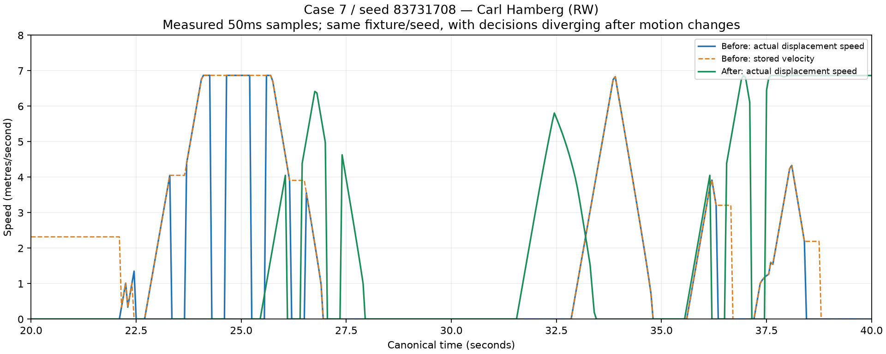

# Match Motion Continuity v1 — delivery report

Canonical V2 locomotion and normal career Match 2D playback have been changed and locally committed. The measured action-phase freeze is eliminated in ordinary live play, and the browser displays the recorded trajectory between simulation ticks. **Human acceptance is pending; v2.1 is not marked fully Human-QA approved.**

Across the three fixed QA fixtures, full-stop episodes fall about **30% per live player-minute**, continuous-movement segments last about **41% longer**, and ticks with a frozen position despite a meaningful stored velocity fall from **581,732 to zero**. Actual distance increases **6.3%**. This does not mean every player is always moving: holds, screens, contact, rule constraints and restarts remain.

The motion work changes opportunities. In twenty paired full matches, goals and shots increase, while turnovers and keeper save percentage remain close to the v2.1 sample. Transition finishes, close chances and actual whistles increase materially. **This is not a claim of statistical equivalence to v2.1.** No scoring, save, turnover, attack-identity or foul coefficients were retuned to conceal those changes.

## Root cause and evidence

The primary problem was the canonical executor. A body moved only in its action's `EXECUTING` phase. Preparation, commitment, recovery and some completed-action intervals froze its position while retaining a nonzero velocity. That produced the visible interrupted runs and made downstream motion projection use a velocity the body was not actually following.

The renderer added another discontinuity: live play drew only the latest simulation snapshot, and replay used a 50ms interval. Replay already had linear interpolation; its presentation clock did not drive it at display cadence. The retained browser measured about 15 live pose changes/second and 20 replay pose changes/second at 1×.

The archived v2.1 poses were faithful at their recorded timestamps. The pinned-source baseline reproduced all three scores and matched all retained archived frame hashes. Its 250ms sampling outside ball flight could omit short intermediate movement/stop boundaries. New archives retain every live 50ms pose, including the tick leaving live play, without storing a second simulation or adding an orientation/velocity format.

See the [measured trajectory](final/trajectory.svg), [raw comparison](final/comparison.json), [full match and scene video](final/delivery-browser/full-match-and-scenes.webm), and [live/replay speed video](final/delivery-browser/normal-career-motion.webm). The chart compares actual displacement with the old stored velocity for one real field player; the same seed does not imply that subsequent decisions remain identical after physical movement changes.

The resumed checkpoint was `706cec7`, with implementation, paired regression, continuation proof and all three browser checks already complete. Only the full game suite completion, documentation and local evidence commits remained. The resumed run reused those results without repeating simulations, benchmarks or browser QA. The final full suite passed 2,304/2,304.

The [canonical cue video](final/delivery-browser/canonical-cues.webm) and [cue receipt](final/delivery-browser/canonical-cues.json) cover actual passer release, support, M6 screen, help/recovery and transition events. Some event types are intentionally omitted from the compact archive event list; the cue catalogs observe the real canonical events and verify their frame hash against the archived trajectory. They do not infer or fabricate events from pixels.



## Before and after motion

The diagnostic definition is developer-only: meaningful motion at least 0.5m/s, followed by at least three consecutive ticks below 0.1m/s, then meaningful motion again during uninterrupted live play. Dead balls and stopped official-clock intervals do not create episodes. Continuous segments include slower nonstationary bridges after meaningful motion starts. Phase-group segments split at semantic phase changes without implying a physical stop. Keepers have their own group.

| Case / seed | Stops per live player-minute before → after | Median stop seconds before → after | Mean continuous segment seconds before → after | Target changes/player-minute before → after | Velocity resets before → after | Actual distance km before → after |
|---|---:|---:|---:|---:|---:|---:|
| 7 / 83731708 | 17.93 → 12.43 | 0.85 → 1.20 | 1.09 → 1.54 | 147.88 → 130.99 | 6,030 → 3,512 | 45.52 → 49.57 |
| 3 / 2643779579 | 17.83 → 12.31 | 0.85 → 1.20 | 1.11 → 1.59 | 150.99 → 136.92 | 6,139 → 3,448 | 47.95 → 52.58 |
| 28 / 2543053647 | 17.87 → 12.70 | 0.85 → 1.25 | 1.13 → 1.56 | 159.07 → 133.20 | 6,074 → 3,489 | 48.92 → 49.17 |

Total movement segments: **41,954 → 32,119**. Velocity resets: **18,243 → 10,449**. The remaining median holds are longer because many short mechanical interruptions have been removed. Their durations are not a target imposed on gameplay.

| Field-player phase group | Mean continuous segment seconds before | After |
|---|---:|---:|
| Settled defensive movement | 0.880 | 1.321 |
| Off-ball support | 1.099 | 1.386 |
| Pivot movement | 1.338 | 1.769 |
| Transition running | 1.738 | 1.985 |
| Retreat | 1.744 | 2.214 |
| Settled ball carrier | 0.526 | 0.634 |

These are phase-based field-player groups, not an exclusive lateral-shift classifier. Detailed tick records include duty, action, phase, target, position, velocity, speed, acceleration, turn and distance for the retained diagnostic window. Every tick contributes to the full-match statistics. Sources: [before](final/measurements/before/summary.json), [after](final/delivery-motion/summary.json). The early development classifier was corrected and tested; earlier progress estimates are superseded by this matched definition.

## Match-realism regression

Twenty fixed fixture/seed recipes, indices 0–19, use the original pinned career inputs. Every match completed. No outliers were removed. Source fingerprints stayed fixed during the batch. The three QA fixtures also completed independently; their original archived results remain intact.

| Per-match mean | v2.1 paired before | Motion after |
|---|---:|---:|
| Goals | 47.25 | 50.65 |
| Possessions | 115.20 | 129.80 |
| Shots | 92.65 | 103.20 |
| Career turnovers | 27.80 | 31.55 |
| Non-shot losses | 24.00 | 26.10 |
| Keeper saves / (goals + saves) | 42.23% | 46.52% |
| Transition starts | 111.55 | 124.95 |
| Transition shots | 2.35 | 6.00 |
| Backcourt shot share | 61.98% | 45.77% |
| Wing shot share | 6.71% | 9.37% |
| Close shot share | 31.31% | 44.86% |
| Actual contact whistles | 21.10 | 43.55 |

Goals increase 7.2%, possessions 12.7%, shots 11.4%, and career turnovers 13.5%. The effects are physical and causal: bodies now cover the action-phase intervals, receiver projection follows their actual braking/steering, and a missed contact intention no longer hides a genuine shoulder crossing. Those changes expose more finishing space and different contact geometry. The release, save, scoring and foul coefficients remain unchanged. Stronger movement is not counteracted with outcome quotas or a disguised new balance phase.

Full before ranges, after ranges, per-match receipts, input recipes, contextual shots, source hashes and timing are in [comparison](final/comparison.json) and [regression](final/delivery-regression/aggregate.json). Development trial summaries are retained in [experiments](experiments-summary.json); duplicated inputs and temporary saves were removed after their summaries were preserved.

## Required delivery record

1. **Starting checkpoint:** primary workspace on `main`, HEAD `357f311`, following `a6f3cc8`, `edd66cf`, `709bfa4`, `29f62e3`, `b6a0e38`, and `357f311`. Canonical player matches remain V2.
2. **Initial status and preservation:** the existing changes to `apps/game/app/match-qa/page.tsx`, `apps/game/lib/matchQa/qaHarness.ts`, and `apps/game/scripts/season-audit.ts` were preserved. `.claude/`, `.tmp-final-benchmark.ts`, and `docs/audit/` were preserved. Their task-start record is [checkpoint](checkpoint.json); final verification is recorded separately.
3. **Failure reproduced:** the original 19–30, 25–25 and 25–37 results and retained archived frame hashes reproduced from pinned v2.1 source. Actual displacement showed repeated zeros while stored velocity remained meaningful. The retained 1× browser also showed limited pose-update cadence.
4. **Layer breakdown:** canonical executor primary; faithful but lower-rate archive sampling secondary; live snapshot drawing and replay interval clock added presentation stutter. No archive corruption or replay resimulation was found.
5. **Baseline diagnostics:** all three full matches were observed tick by tick; per-player, phase-group and possession summaries use the definition above. Raw detailed windows are ticks 400–800, and archives retain full recorded poses.
6. **Movement state:** live locomotion integrates once per canonical tick independently of the hands/action lifecycle. Existing position and velocity fields are sufficient; no new engine or locomotion save schema was introduced.
7. **Velocity continuity:** compatible off-ball preparation/recovery carries existing pace; stationary intentions brake. Completed actions do not automatically freeze a moving body. The held-ball step budget, contact, boundaries and existing discrete physical states retain authority.
8. **Target/intent continuity:** the existing `sustain` and relational target-refresh machinery remains. No new target lottery, global decision cooldown or random idle motion was added. The measured meaningful target/intent changes fall as unnecessary stop/restart cycles disappear.
9. **Acceleration/deceleration:** original longitudinal pace, top-speed and forward-acceleration profiles remain. Vector steering uses bounded braking/redirection, with a scoped 2× acceleration braking/turning bound; forward speed gain stays bounded by the original acceleration. Physical non-penetration/arrival/rule constraints can still impose discrete impulses.
10. **Direction changes:** compatible destinations redirect the carried vector instead of replacing its heading with a full-speed vector or first requiring a full stop. Free-flight steering and projection are covered by focused tests.
11. **Ball carrier:** the existing drive-release decision can overlap movement. Braking travel is charged to the handling budget; locomotion cannot grant a fourth held-ball step. Grounded/airborne release timing and goalkeeper reading remain the retained model.
12. **Off-ball attack:** existing width, support, combination, recycle and transition relationships continue to own destinations. Passing/receiving intentions can brake or carry movement without an artificial action-phase freeze. After the actual pass release, the existing role support target drives the legs while the hands recover. Tactical holds remain.
13. **M6:** line-running/roll targets use the same continuous motor; a stationary screen waits for planted feet. Named feeds, goal-area legality and existing screen/roll decisions remain authoritative.
14. **Defensive shift:** shared 6:0/5:1 zonal responsibility and target allocation remain. Mean field-player settled defensive segments improve from 0.880s to 1.321s. Ownership is not reassigned by nearest-player chasing. If the pivot owner is beaten and all free healthy neighbours are occupied, coverage takes precedence over optional extra help; the beaten player keeps recovering.
15. **Help/recovery:** existing active movement re-aims HELP/RECOVER/CONTAIN without zeroing velocity. A contact intention or recovery phase cannot falsely claim that a physically passed defender is still containing the shoulder.
16. **Transition/retreat:** possession and settled-phase handoffs retain momentum. Mean transition segments improve 1.738s → 1.985s and retreat 1.744s → 2.214s. The increased transition finishes are disclosed in the paired table.
17. **Action/decision cadence:** existing action durations, reaction/read budgets and tactic selection remain. Compatible off-ball phases carry pace without receiving extra forward acceleration before execution. Hands readiness for a named pass is governed by its persisted ready tick, not a locomotion phase boundary.
18. **Archive:** every live pose and the tick leaving live play are captured. Dead-ball sampling and event capture remain. The existing compressed integer-centimetre format is retained. Canonical zero is normalized so raw observed poses round-trip through JSON and i16 storage exactly.
19. **2D interpolation:** live drawing reads the recorded buffer; replay reads immutable decoded frames. `requestAnimationFrame` drives bounded fractional canonical time. Linear interpolation changes position only between actual recorded poses, with discrete score/period/population semantics and no CSS easing or extrapolation.
20. **Pause/resume:** the presentation cursor freezes; resumption starts a fresh wall-time anchor without accumulated pause debt. Browser assertions verified stable paused poses at every tested speed.
21. **Seek/replay:** seek selects an exact recorded canonical tick and pauses. Subsequent playback starts from that tick with no old interpolation anchor. All sampled player and ball positions equal the archive interpolation.
22. **1× observations:** the final committed-state live check records 188 changing-pose frames over four seconds (about 47/second), compared with 61 (about 15/second) on the retained live view. Replay records 184 changes over four seconds (about 46/second), compared with 80 (20/second). Actual 1× scene sequences and video cover all three archives.
23. **4× observations:** 166 changing live-pose frames and 163 replay-pose frames over the four-second final sample. Replay coordinates matched the same recorded path at the observed timestamps.
24. **16× observations:** 185 changing live-pose frames and 156 replay-pose frames over the four-second final sample. A full normal career replay completed at 16×; final score and recorded trajectory remained unchanged.
25. **Stop episodes:** about 30% fewer per live player-minute across the selected fixtures. Per-case medians, definitions and denominators are shown above; legitimate stops are not classified as bugs merely because a player stands.
26. **Movement segments:** 41,954 → 32,119 completed segments, with pooled mean duration about 1.11s → 1.56s. Slow nonstationary bridges count in continuous duration; phase grouping never manufactures a physical stop.
27. **Target changes:** roughly 148–159 → 131–137 meaningful target changes/player-minute in the three cases, using a 0.1m change threshold. Detailed target/action samples are retained for inspection.
28. **Velocity resets:** 18,243 → 10,449. Frozen-position ticks despite meaningful nominal velocity: 581,732 → 0 during measured ordinary live play. Remaining impulses include actual contact, constraints, arrivals and retained discrete states.
29. **Trajectory evidence:** [figure](final/trajectory.svg), [selection](final/trajectory-selection.json), raw tick windows under `final/measurements/`, per-render-frame JSON under `final/delivery-browser/`, and recorded videos. Static screenshots are supporting views, not the continuity proof.
30. **Realism regression:** all twenty paired matches complete; the table above reports every requested minimum metric and the material shot-mix/whistle effects. Calibration equivalence is not claimed and v2.1 full Human-QA approval remains withheld.
31. **Tactics:** 6:0/Balanced baseline and full QUICK, WIDTH, COMBINATION, DIRECT and FIVE_ONE variants complete through the actual career bridge. Their outputs differ and no tactic is inert. The full variant runs in `final/tactics/` precede the final released-passer/coverage correction; the final 218-test core suite covers tactic/defence behavior after that correction. No additional tactic benchmark was run on resumption.
32. **Attributes:** original capability/profile construction and locked player data are unchanged. Focused tests retain distinct fast/slow acceleration and distance; keeper and execution capability regression tests also pass.
33. **Fatigue:** original capacity/endurance formulas remain. Speed, acceleration and braking use the player's existing energy-dependent capacity. Fatigue does not install a stop/start timer. Workload now follows the integrated live velocity.
34. **Determinism:** V2 deterministic-state/replay tests pass. The representative continuation receipt compares normalized canonical state, frames and results for the same seed/input after a JSON round-trip.
35. **Save/load:** reload at tick 555 yields the same full final canonical state, frames, result and archive. See [continuation proof](final/continuation-proof.json). Raw JSON object insertion order is not used to claim cross-wrapper state equivalence.
36. **Archive/replay:** diagnostic and actual production archives are structurally identical; decoded archived poses equal the observed production frames. Browser replay leaves the stored archive unchanged and never runs the engine again.
37. **Browser QA:** normal `/career/match-day/…` routes, live/replay 1×/4×/16×, pause, exact seek, full replay, all three seed archives, and genuine scene sequences pass. The committed React-ref correction was followed by a fresh speed/pause/seek run. A zero-sign serialization correction does not change rendered coordinates or trajectory.
38. **Focused tests:** eight canonical motion tests, five playback/codec tests, and four diagnostic tests cover carried momentum, steering/arrival, compatible targets, paced attributes/fatigue, projection, determinism, pause/seek clock semantics, storage, classification and phase accounting. No pixel assertions or weakened legacy duel assertions were used.
39. **V2 engine tests:** all **218 core tests pass**, plus **9 V2 protocol/scenario tests**. Original duel, contact, geometry, keeper, transitions, restarts, exchanges, full-match, determinism and replay assertions remain.
40. **Full game tests:** the final portable full recipe passes **2,304/2,304**, with zero failures, skips or cancellations, on the final implementation. Final production/management-command/save/archive and playback tests pass **11/11**, including the zero-sign regression. The five new playback tests are registered in the canonical game recipe. Full game coverage includes season-one → season-two, substitutions, timeout, halftime/full time, management and Game Experience behavior.
41. **Typechecks:** all workspace typechecks pass; the final production build also runs TypeScript. Focused lint passes for the changed playback component/helpers. Existing unrelated files were not reformatted or repaired.
42. **Production build:** isolated `.next-game-motion-v1` build passes. Its generated Next type includes are committed. The retained v2.1 build directory and server remain available.
43. **Performance:** final twenty-match batch completes in about 228s while other verification runs execute; recorded per-match simulation timing is retained. The separate motion diagnostic runs complete each selected full match in roughly 7–10s without browser rendering. Recorded steady 1× live/replay cadence is about 47/46 changing poses per second. 4×/16× remain usable, and archives use the existing compact codec. Video uses existing Playwright/FFmpeg; no recording dependency was installed.
44. **Remaining limitations:** collision/non-penetration, held-step exhaustion, planted/airborne actions and restarts retain discrete constraints. Full biomechanics and body orientation were not added. Reach-time planning remains the existing approximation. Old archives retain old trajectories. The physical opportunity/contact mix changes as reported; Human approval must assess the 1× flow and these effects.
45. **Local commits:** `1934e14` diagnostics/baseline, `5fcb206` initial canonical locomotion, `25b341b` retained pace/contact truth refinement, `0654d4a` faithful playback/archive capture, and `27eb0e7` integer-pose round-trip correction. `706cec7` adds canonical released-passer support and coverage handoff during recovery. Final evidence/documentation commits follow; the final repository receipt records the resulting history.
46. **Working tree:** motion source and evidence are committed locally. The pre-existing three modified files and three untracked paths remain; final status is recorded in the repository receipt.
47. **Motion worktree/stashes:** `handball-motion-lab` remains at `197d2a8` on `motion-lab`, with its existing untracked `.claude/`. Both paused Pack #5 stashes remain. They were not popped, applied or edited. Git auto-maintenance emitted permission errors for old `m16b`/`m17b` metadata on the first commit; subsequent commits disabled automatic GC and the active worktree/stashes verified unchanged.
48. **Push confirmation:** **NOTHING WAS PUSHED.** All commits and artifacts are local; the QA server binds to 127.0.0.1.
49. **Exact start command:** from the repository root:

    ```powershell
    $env:HM_NEXT_DIST_DIR = '.next-game-motion-v1'
    npm run start --workspace=@handball-manager/game -- --port 3010 --hostname 127.0.0.1
    ```

    The motion QA server is already running. Use this command when starting it again after the existing listener has stopped.
50. **Exact URL:** **http://127.0.0.1:3010**. The existing v2.1 server remains at http://127.0.0.1:3009.
51. **How to QA movement continuity:** follow [HOW-TO-QA](HOW-TO-QA.md) to import all three motion archives into the normal Load Game UI. Select 1× and watch support after release, M6 movement, defensive shift/recovery and transition/retreat; then pause/resume, seek, 4× and 16×. For live play, import the original kickoff envelopes on the motion origin. The guide distinguishes the unchanged old completed matches from the newly played motion trajectories.

## Validation receipts

- [Core V2 tests](final/v2-core-tests.log), [protocol tests](final/v2-protocol-tests.log), [production tests](final/production-tests.log), [playback tests](final/playback-tests.log), [diagnostic tests](final/diagnostic-tests.log).
- [Continuation proof](final/continuation-proof.json), [browser speed receipt](final/delivery-browser/receipt.json), [actual handball scenes](final/delivery-browser/handball-scenes.json).
- [Full game tests](final/full-game-tests.log), [canonical cues](final/delivery-browser/canonical-cues.json), [evidence provenance](final/EVIDENCE.md).
- [Typechecks](final/typechecks.log), [production build](final/build.log), [playback lint](final/playback-lint.log).
- [Fixed-source regression aggregate](final/delivery-regression/aggregate.json), [per-match summaries](final/delivery-regression/matches-summary.json), [input/seed provenance](final/delivery-regression/seed-set.json).

The full-game run summary and final preservation/status checks are recorded in the final repository receipt. The scoped changes add no Home/Squad/editor redesign, no new tactics, no new match engine, no probability quotas and no fake perpetual movement.
